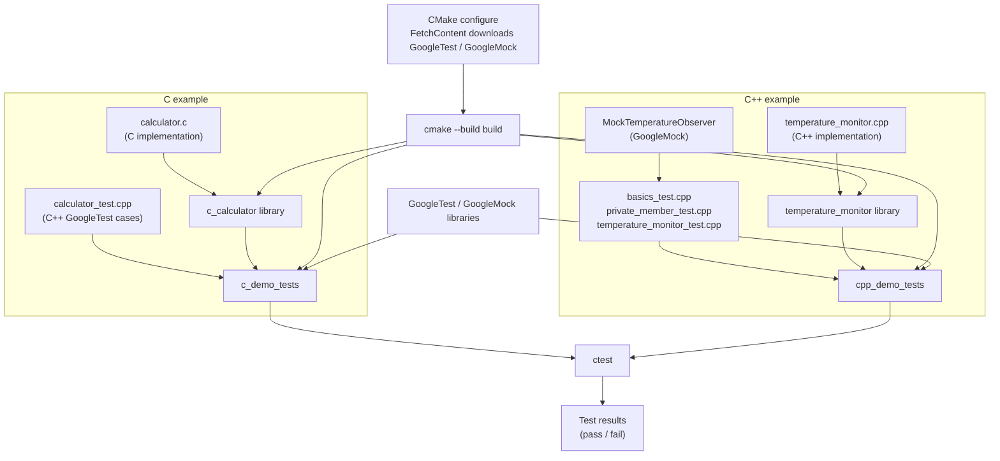
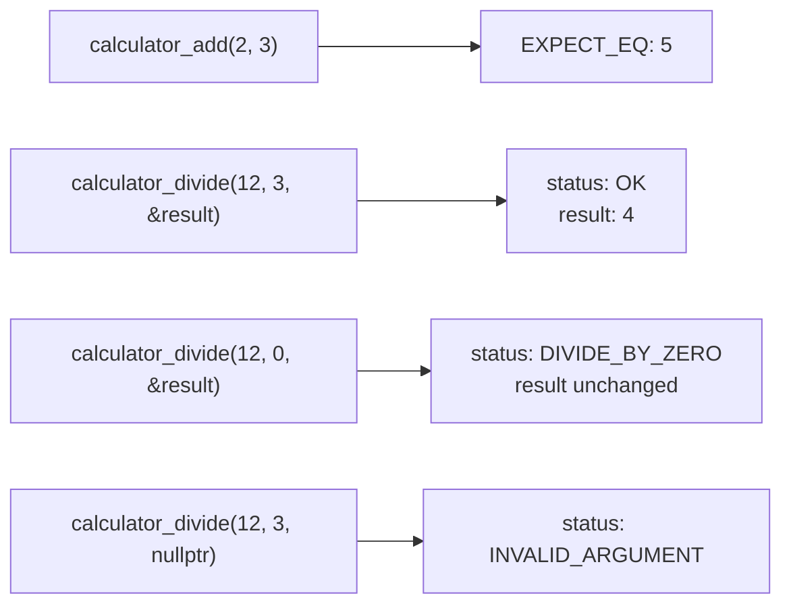
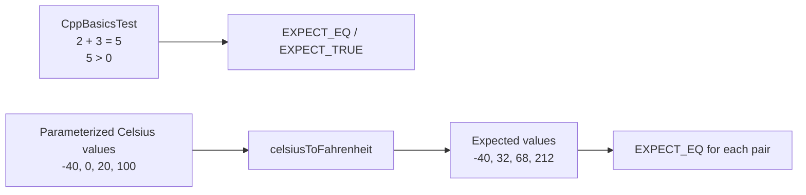
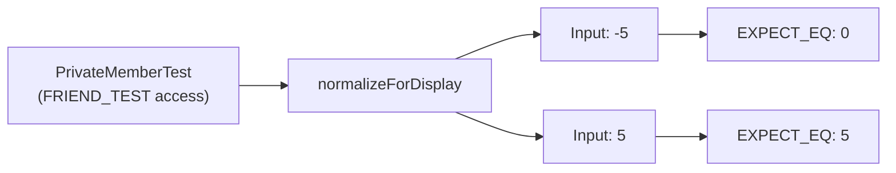
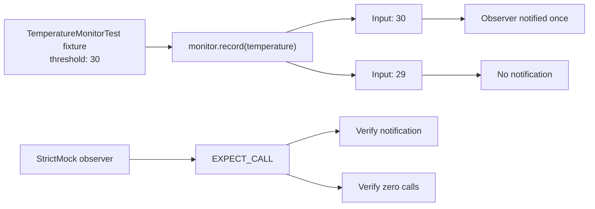

# How to GoogleTest

A small, progressive C and C++ project for learning GoogleTest (and GoogleMock)
with CMake. Each example is a real library with a test target, so you can change
the implementation and see the tests catch regressions.

## Requirements

- CMake 3.20 or newer
- A C11 and C++17 compiler
- Git and an internet connection the first time you configure (CMake downloads
  GoogleTest 1.15.2 with `FetchContent`)

GoogleTest is a C++ framework. The C example keeps its implementation in C and
uses a small C++ test runner to call its C API.

## Build and run

From the project root:

```sh
cmake -S . -B build
cmake --build build
ctest --test-dir build --output-on-failure
```

Run a single test executable directly for GoogleTest's filtering and output:

```sh
./build/c_demo/c_demo_tests
./build/cpp_demo/cpp_demo_tests --gtest_filter=TemperatureMonitorTest.*
```

For example, `--gtest_filter=CppBasicsTest.*` runs only the basic C++ examples.
To start over with a clean build, remove the generated `build/` directory.

## How the tests exercise the source



The C source is compiled as C and linked into a C++ GoogleTest runner. The C++
tests link the C++ library directly; GoogleMock supplies a test double for the
monitor's observer interface. CTest runs the discovered GoogleTest cases from
both executables and reports the results.

## Learning path

### 1. C API: assertions and error cases

`c_demo/src/calculator.c` contains ordinary C functions. Its C++ test runner
checks successful calculations, division by zero, and invalid arguments in
`c_demo/tests/calculator_test.cpp`. The `extern "C"` guards in the header make
the API usable from both C and C++.



### 2. C++: test cases and fixtures

`CppBasicsTest` demonstrates `TEST`. `TemperatureConversionTest` is a
parameterized test fixture that checks known Celsius/Fahrenheit pairs. The
tests exercise observable behavior rather than implementation details.



### 3. Private members

`PrivateMemberTest.NormalizeClampsNegativeValues` uses GoogleTest's
`FRIEND_TEST` to access one private helper. This technique couples the test to
the class implementation; prefer testing through the public interface unless
direct access is necessary for a specific reason.



### 4. GoogleMock

`TemperatureMonitor` depends on its `Observer` interface.
`MockTemperatureObserver` and `EXPECT_CALL` show how to isolate the monitor
from that dependency, verify interactions, and check that no notification is
sent when the threshold is not reached.



## Project layout

```text
CMakeLists.txt
c_demo/
  include/calculator.h
  src/calculator.c
  tests/calculator_test.cpp
cpp_demo/
  include/temperature_monitor.h
  src/temperature_monitor.cpp
  tests/
    basics_test.cpp
    private_member_test.cpp
    temperature_monitor_test.cpp
```

The root `CMakeLists.txt` fetches GoogleTest and adds both examples. Each
subdirectory defines a library and a test executable, then registers the
individual GoogleTest cases with CTest.
